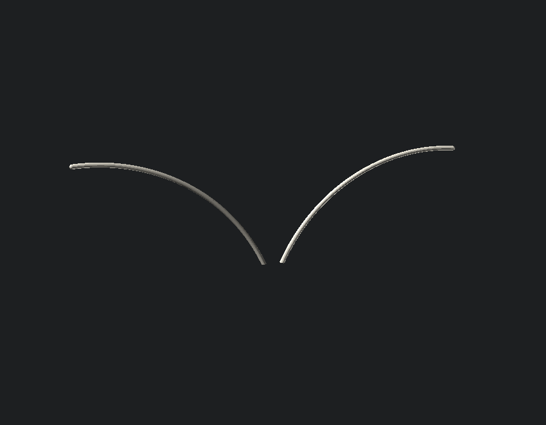
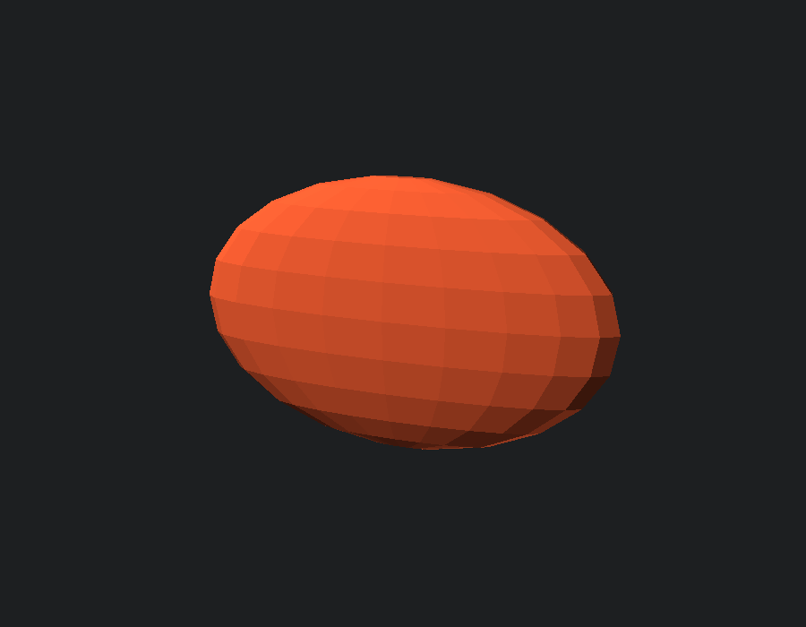
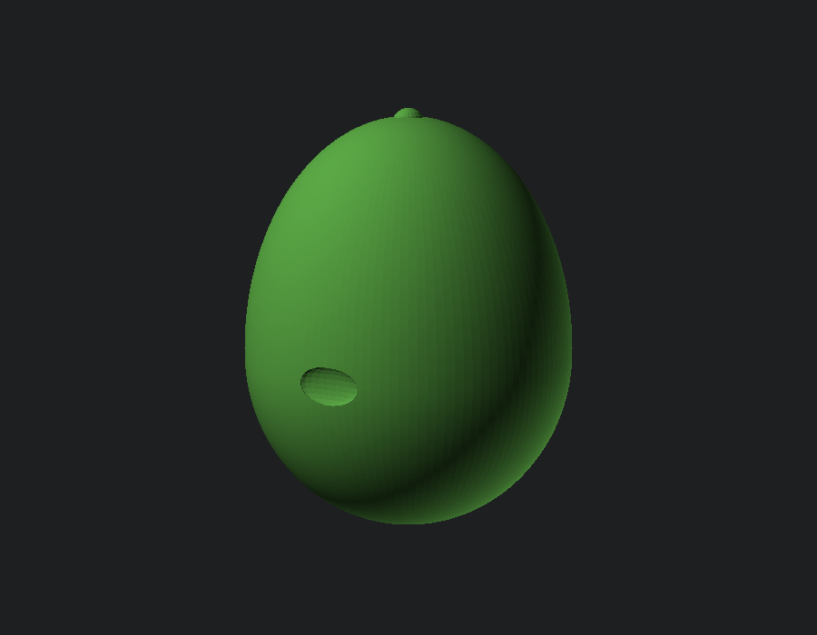
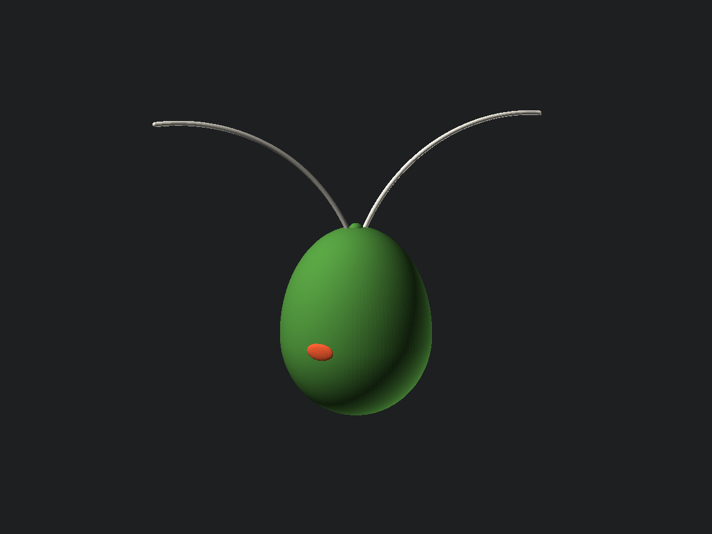

# Catalog

Every part of the project, with its 3D view, description and files. Drag a model to rotate it.

## Parts

  

    

      <model-viewer src="../generated/chlamydomonas_flagella.glb" reveal="manual" camera-controls touch-action="pan-y"
          shadow-intensity="0.8" exposure="1.1" tone-mapping="neutral" alt="The two flagella">
        

          <button class="md-button md-button--primary ti-reveal" onclick="this.closest('model-viewer').dismissPoster()">View in 3D</button>

      </model-viewer>
    

    

      <h3>Flagella</h3>
      
The two flagella (cilia), about 0.25 µm thick and 10–12 µm long, leaving the cell on either side of the
      papilla. The cis flagellum is the one nearest the eyespot. Both beat in one plane; the model shows them at the
      start of the power stroke.

      
<code>trappy-inator:chlamydomonas@…</code> · part <code>flagella</code>

      
Tunable: length of each flagellum, diameter, exit spacing, exit angle, bend.

      
<a href="../generated/models/chlamydomonas_flagella.stl" download>STL</a> ·
        <a href="../playground/">Open in the Playground</a>

    

  

  

    

      <model-viewer src="../generated/chlamydomonas_eyespot.glb" reveal="manual" camera-controls touch-action="pan-y"
          shadow-intensity="0.8" exposure="1.1" tone-mapping="neutral" alt="The eyespot">
        

          <button class="md-button md-button--primary ti-reveal" onclick="this.closest('model-viewer').dismissPoster()">View in 3D</button>

      </model-viewer>
    

    

      <h3>Eyespot</h3>
      
The orange-red light sensor: layers of carotenoid globules, about 0.6–1.5 µm² in area, near the cell
      equator on the side of the cis flagellum. In the model it stands slightly proud of the surface so it can be seen
      and printed in its own colour.

      
<code>trappy-inator:chlamydomonas@…</code> · part <code>eyespot</code>

      
Tunable: length, width, thickness, angle from the beat plane, height from the equator, tilt.

      
<a href="../generated/models/chlamydomonas_eyespot.stl" download>STL</a> ·
        <a href="../playground/">Open in the Playground</a>

    

  

  

    

      <model-viewer src="../generated/chlamydomonas_cell.glb" reveal="manual" camera-controls touch-action="pan-y"
          shadow-intensity="0.8" exposure="1.1" tone-mapping="neutral" alt="The cell body">
        

          <button class="md-button md-button--primary ti-reveal" onclick="this.closest('model-viewer').dismissPoster()">View in 3D</button>

      </model-viewer>
    

    

      <h3>Cell body</h3>
      
A prolate cell about 10 µm long and 8 µm wide, optionally egg-shaped and narrower towards the flagella, with
      the papilla between the two flagella. The eyespot sits in a pocket on its surface.

      
<code>trappy-inator:chlamydomonas@…</code> · part <code>cell</code>

      
Tunable: length, width, anterior taper, papilla height and width.

      
<a href="../generated/models/chlamydomonas_cell.stl" download>STL</a> ·
        <a href="../playground/">Open in the Playground</a>

    

  

## Assemblies

  

    

      <model-viewer src="../generated/chlamydomonas.glb" reveal="manual" camera-controls touch-action="pan-y"
          shadow-intensity="0.8" exposure="1.1" tone-mapping="neutral" alt="The whole Chlamydomonas cell">
        

          <button class="md-button md-button--primary ti-reveal" onclick="this.closest('model-viewer').dismissPoster()">View in 3D</button>

      </model-viewer>
    

    

      <h3><em>Chlamydomonas reinhardtii</em></h3>
      
The whole cell: cell body, eyespot and both flagella, to scale. At the default print scale of 5 mm per µm the
      cell is 50 mm long. Each part is a separate body, so it can be printed in its own filament.

      
<code>trappy-inator:chlamydomonas@…</code>

      
Contains: 1 × cell body, 1 × eyespot, 2 × flagellum.

      
<a href="../generated/models/chlamydomonas.3mf" download>Coloured 3MF</a> ·
        <a href="../playground/">Open in the Playground</a> · <a href="../bom/">Bill of materials</a>

    

  

