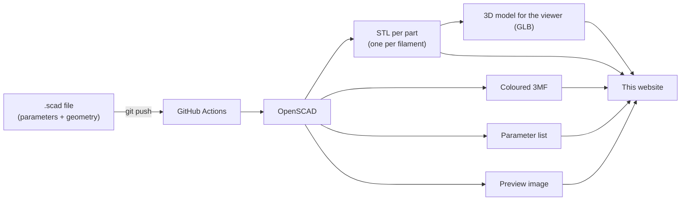

# How it works

This page explains the machinery behind every Trappy-Scopes project website: where the 3D files come from, how the
models are shown and changed in your browser, and how parts are versioned and cited. It only appears on the
trappy-inator site; instrument sites built from the template show their own content instead.

## From an OpenSCAD file to a part

Every 3D-printed part is an [OpenSCAD](https://openscad.org) file: plain text that describes the shape with
parameters. The repository stores only these source files. Everything else is generated.



1. You edit a `.scad` file and push it to GitHub.
2. GitHub Actions runs OpenSCAD on it (`tools/build_models.sh`). It writes one STL per colour body, so each can be
   printed in its own filament, a coloured 3MF of the whole assembly, the list of parameters with their ranges, and a
   preview image.
3. The STLs are joined into one GLB file, the format the 3D viewer reads, with one named, coloured node per part
   (`tools/stl_to_glb.py`).
4. MkDocs builds this website around those files and publishes it. Generated files are never committed to the
   repository, so the source stays small and every file on the site comes from the commit it describes.

Parameters are written in OpenSCAD's own Customizer format, which desktop OpenSCAD also understands:

```openscad
/* [Flagella] */
// The flagellum nearest the eyespot (µm)
cis_flagellum_length = 12; // [0:0.5:20]
```

The group in `/* [...] */` becomes a tab, the comment above becomes the description, and `[min:step:max]` becomes
the slider.

## How the website shows and changes models

**Showcase.** The home page shows the GLB built by GitHub Actions with the default parameters. A preview image
appears first; the 3D model loads when you ask for it. The viewer is Google's
[`<model-viewer>`](https://modelviewer.dev): drag to rotate, scroll to zoom, right-drag to pan.

**Playground.** The Playground runs OpenSCAD itself in your browser, compiled to WebAssembly, on your own
computer. Nothing is sent to a server.

1. The form is generated from the part's parameter list, so it works for any OpenSCAD file written in the
   Customizer format.
2. When you move a slider, OpenSCAD renders a quick draft with coarser curves; when you let go, it renders full
   quality.
3. The result is converted to GLB in the browser and handed to the same viewer.
4. Colours never need a re-render: the viewer recolours the parts directly.
5. Downloads (STL per part, coloured 3MF) are generated in your browser from exactly the parameters you chose.

The OpenSCAD build is the official WebAssembly release from [files.openscad.org](https://files.openscad.org),
checked against its published checksum.

## Versions and citations

Every part has a fixed name and two version markers:

| Marker | Example | Set by | Changes when |
|---|---|---|---|
| Name | `trappy-inator:chlamydomonas` | the author | never; a renamed part keeps its old name as an alias |
| Generation | `g1` | the author, by hand | the part no longer fits older versions |
| Revision | `a1b2c3d` | git, automatically | the last commit that changed the part's own files |

The revision shown under each model is read from git when the site is built. A part that has not changed keeps its
revision even when the rest of the repository moves on, so its STL stays byte-identical.

**Citing a configuration.** The Playground link records only the parameters you changed, so together with the part
name and revision it describes exactly one model. For example:

> Chlamydomonas facsimile (`trappy-inator:chlamydomonas`, rev a1b2c3d),
> configured at https://trappy-scopes.github.io/trappy-inator/playground/?cis_flagellum_length=8

Releases of a project will also receive a DOI through Zenodo, so a paper can cite a fixed, archived version.

## Where things live

```text
trappy-inator/
├── cad/parts/chlamydomonas/
│   ├── chlamydomonas.scad      the part: parameters + geometry
│   └── chlamydomonas.json      named presets (wild type, deflagellated)
├── docs/                       the pages of this website
│   └── assets/playground/      the Playground (form, OpenSCAD worker, GLB writer)
├── tools/                      build scripts used locally and by GitHub Actions
├── mkdocs.yml                  site configuration and the Trappy-Scopes theme
└── LICENSES/                   CERN-OHL-S-2.0, GPL-3.0-or-later, CC-BY-SA-4.0
```

The look of the site (colours, theme, viewer) is defined once here and shared by every Trappy-Scopes project.

## Start your own project

1. Create a new repository from this template on GitHub.
2. Replace the Chlamydomonas part with your own `.scad` files, written with Customizer parameters.
3. Push. GitHub Actions builds the files and the website.

## Licences

Hardware designs are licensed under CERN-OHL-S-2.0, software under GPL-3.0-or-later and documentation under
CC-BY-SA-4.0. Anyone may build, modify and sell what is published here, but modified versions must be shared under
the same licences.

## Credits

| Project | Used for | Licence |
|---|---|---|
| [OpenSCAD](https://openscad.org) | parametric CAD, in GitHub Actions and in the browser | GPL-2.0-or-later |
| [`<model-viewer>`](https://modelviewer.dev) | 3D viewer | Apache-2.0 |
| [Material for MkDocs](https://squidfunk.github.io/mkdocs-material/) | website theme | MIT |
| [OpenSCAD Playground](https://github.com/openscad/openscad-playground) | the approach for running OpenSCAD in the browser | GPL-2.0-or-later |
| [GitBuilding](https://gitbuilding.io) (planned) | BuildUp syntax for assembly instructions | GPL-3.0 |
