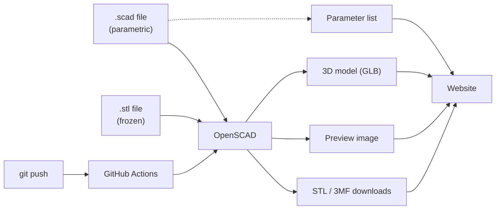

# How it works

Where the 3D files come from, how the website shows them, and how the Playground changes them in your browser.

## Two kinds of part

| Kind | Source in the repository | Example | What the build makes |
|---|---|---|---|
| **Parametric** | an OpenSCAD file (`.scad`) | the Chlamydomonas cell, the pump box | STL per colour body, coloured 3MF, 3D model, preview image, parameter list; editable in the Playground |
| **Frozen** | a finished STL, e.g. exported from Fusion 360 | the trappyframe plates | the same STL for download, 3D model, preview image; not editable |

Both kinds are versioned the same way (see [Versions and citations](versions-and-citations.md)). A frozen part
can be converted to OpenSCAD later; until then it is shown and cited exactly as it is.

## From source to website



1. You change a `.scad` or `.stl` file and push to GitHub.
2. GitHub Actions runs `tools/build_models.sh` with OpenSCAD.
    - **Parametric parts:** OpenSCAD renders one STL per colour body (each can be printed in its own filament),
      a coloured 3MF of the whole assembly, the parameter list with its ranges, and a preview image.
    - **Frozen parts** (`cad/frozen/<part>/*.stl`): the STL is copied for download as it is. OpenSCAD imports it
      only to draw the preview image and to produce a clean binary STL for the 3D model. An optional file
      `cad/frozen/<part>/colour` (one line, e.g. `#3A3A3A`) sets its display colour.
3. `tools/stl_to_glb.py` joins the STLs into one GLB, the format the viewer reads, with one named, coloured
   node per part. Normals are smoothed on curved surfaces and kept sharp at edges.
4. MkDocs builds the website around those files and publishes it to the `gh-pages` branch. Generated files are
   never committed to `main`, so the repository holds only sources and every file on the site comes from the commit
   it describes. The site is also rebuilt every night, so changes to the shared look reach it without a push.

## How the website shows models

**Showcase.** A page shows the prebuilt GLB with Google's [`<model-viewer>`](https://modelviewer.dev). The preview
image appears first; the 3D model loads when you ask for it. Drag to rotate, scroll to zoom, right-drag to pan.
Hovering a part name highlights that part.

**Playground** (parametric parts only). OpenSCAD itself runs in your browser, compiled to WebAssembly, on your
own computer; nothing is sent to a server.

1. The form is generated from the part's parameter list, so it works for any OpenSCAD file written in the
   Customizer format (below). There is no code written per part.
2. Moving a slider renders a quick draft with coarser curves; letting go renders full quality.
3. The result is converted to GLB in the browser (`docs/assets/playground/glb.js`) and shown in the same viewer.
4. Colours never need a re-render: the viewer recolours the parts directly.
5. Downloads are generated in your browser from exactly the parameters you chose.

The browser build of OpenSCAD is the official WebAssembly release from
[files.openscad.org](https://files.openscad.org), checked against its published checksum.

## Writing parameters

Parameters use OpenSCAD's own Customizer format, which desktop OpenSCAD also understands:

```openscad
/* [Flagella] */
// The flagellum nearest the eyespot (µm)
cis_flagellum_length = 12; // [0:0.5:20]
```

- `/* [Flagella] */` starts a group, which becomes a tab in the Playground. `/* [Hidden] */` hides what follows.
- The comment on the line above becomes the description. Put only the range after the value, or OpenSCAD ignores it.
- `[min:step:max]` becomes a slider; `[a, b, c]` becomes a drop-down list.
- Name parameters so they read as their own label: `cis_flagellum_length` is shown as "Cis flagellum length".
  No abbreviations; units go in the description.
- Set curve smoothness only through `$fa` and `$fs` (in the Hidden group), never with `$fn` on individual shapes.
  The Playground overrides `$fa`/`$fs` to draw quick drafts.
- Colours are text parameters holding a hex colour (`"#4C8C3A"`); the Playground shows them as colour pickers.
